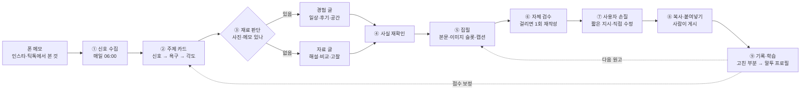

# 트렌드에 맞춘 포스팅 자동화 — 구조

설계: 2026-10-15 (한국시간), Claude. 근거: [00 요구](00_요구사항.md) · [02 트렌드 신호](02_트렌드신호_2026-10.md) · [03 국내 글·정책](03_국내글_패턴과_정책.md). 글을 쓰는 세부 규칙은 [05 생성 규칙](05_생성규칙.md).

**목표:** 매일 아침 그날의 신호에서 고른 주제로 **거의 완성된 글 1~2편이 이미 준비되어 있다.** 사용자는 읽고 조금 고친 뒤, 복사해 붙여넣고 게시한다.

## 1. 한눈에



**사용자가 손대는 곳은 세 군데뿐이다.** 주제 고르기(또는 아침에 준비된 글 그대로 받기), 손질, 붙여넣기. 독자·핵심 질문·소제목·출처를 사용자가 채우는 단계는 없다.

## 2. 사용자의 하루

| 때 | 화면 | 사용자가 하는 일 |
|---|---|---|
| 아침 | **오늘의 주제** 카드 5개 + 이미 써 둔 원고 1~2편 | 원고를 그대로 열거나 다른 카드를 고른다 |
| (선택) | 카드에 "사진 있으면 더 좋아요: 외관, 메뉴판, …" 촬영 목록 | 사진을 올리고 한 줄 메모("비 와서 한산, 라떼 너무 달았음") |
| 1~2분 뒤 | 완성 원고 미리보기 (티스토리/네이버 모양) | 읽는다 |
| 손질 | "더 담백하게" · "짧게" · "이모티콘 빼기" · "이 문단은 내 생각 쪽으로" 버튼, 직접 수정 | 바꾸고 싶은 곳만 |
| 게시 | 제목 복사 · 본문 복사 · 태그 복사 · 사진 순서표 | 블로그 에디터에 붙여넣고 사진을 올린 뒤 게시 |
| 게시 후 | URL 칸 | 붙여넣기 (1주 뒤 조회·공감은 선택 입력) |

## 3. 단계별 설계

### ① 신호 수집 — 매일 06:00 (한국시간)

| 출처 | 가져오는 것 | 방법 |
|---|---|---|
| 구글 | 한국 '지금 뜨는 검색어' 10~25개, 대략의 검색량, 관련 뉴스 | Trends RSS (비공식. 첫 구현 때 KR 피드가 실제로 오는지 확인) |
| 네이버 | 후보 키워드의 7일·30일 상승률, 월 검색수, 블로그 문서 수 | API HUB: 데이터랩 검색어 트렌드 + 검색 API. 검색광고 API: 연관 키워드·검색수 |
| 다음 | 후보 키워드의 블로그·카페 문서 수, 최신 글 | 카카오 검색 API |
| 유튜브 | 한국 인기 영상 제목·카테고리 (보조) | YouTube Data API `mostPopular` |
| 인스타그램 · 틱톡 | 사용자가 본 챌린지·밈·팝업 | **수동 메모 칸** (폰에서 한 줄). API로는 인기 목록을 얻을 수 없다 |
| 달력 | 시즌 일정 (수능, 세일, 축제, 단풍) | `시즌달력` 표를 사람이 월 1회 갱신 |

- 네이버 데이터랩은 키워드를 미리 넣어야 한다. 그래서 순서가 정해진다. **구글 RSS·뉴스·수동 메모·달력에서 후보 키워드를 뽑고 → 네이버·다음으로 수요와 포화도를 잰다.**
- 저장: `TrendSignal(출처, 키워드, 원점수, 수집 시각, 원문 링크, 메타)`. 원문 링크가 없는 신호는 주제 카드의 근거로 쓰지 않는다.

### ② 주제 카드 — 신호를 글감으로

트렌드는 그대로 제목이 되지 않는다. [아이디어 조사 방법](../../../시장조사/00_아이디어_조사방법.md)의 렌즈를 글감에 맞게 쓴다.

- **아래의 욕구:** 왜 몰렸나 → "독감 주의보"는 "우리 애·우리 부모님은 언제 무료로 맞나"가 된다.
- **질문 모양:** 검색·댓글에 반복되는 "얼마·언제·어디서·뭐가 나아"를 찾는다.
- **하류 추적:** 이 일 다음에 필요한 것은? → 수능 다음에는 "수험생 선물"이 아니라 "수능 끝난 날 뭐 하지"가 온다.
- **신호 충돌:** 무관한 두 신호를 붙인다 → "가을야구 × 편의점 디저트 = 직관 간식".

카드 하나에 들어가는 것:

| 칸 | 예 |
|---|---|
| 제목 후보 | 김장, 직접 담그기·절임배추·사 먹기 중 올해 덜 드는 쪽 |
| 신호 근거 | 배추 -12.85%, 새우젓 +24%, 절임배추 구매 58.9% (아주경제 10/12) |
| 독자의 질문 | 올해는 어떤 방식이 돈과 품이 덜 드나 |
| 각도 (관점 한 문장) | 배추값만 보면 직접이 싸지만, 양념값과 이틀 품을 넣으면 4인 가족 기준 답이 달라진다 |
| 장르 | 비교 (재료가 있으면 + 후기) |
| 필요한 재료 | 없어도 됨. 직접 김장했다면 사진·메모로 후기 추가 |
| 게시 적기 | 10/25~11/10 |
| 수익 연결 | 절임배추·김치 제휴 링크 (네이버 쇼핑커넥트 또는 쿠팡파트너스), 광고 |
| 겹침 확인 | 최근 30일 글과 제목·각도 유사도 |

**점수 (각 0~3점, 합계 순으로 5장 표시)**

| 항목 | 0점 | 3점 |
|---|---|---|
| 시의성 | 상시 | 게시 적기가 지금부터 7일 안 |
| 출처 폭 | 1곳 | 서로 다른 3곳 이상에서 보임 (수동 메모 포함) |
| 수요 대비 포화 | 검색수는 적고 문서는 많음 | 검색수에 비해 문서가 적음 |
| 우리 적합 | 관심 밖·재료 없음·경험 필수 | 사용자 관심(애니·롤·음악·IT·생활)과 닿거나 재료가 있음 |
| 수익 연결 | 없음 | 제휴·광고가 글의 목적과 자연스럽게 맞음 |

점수는 정렬용이다. 사용자가 고르지 않은 카드도 지우지 않고 다음 날 시의성만 다시 계산한다. 가중치는 ⑨에서 실제 성과를 보고 조정한다.

### ③ 재료 판단 → 장르 결정

| 있는 재료 | 장르 |
|---|---|
| 사진 + 방문·사용 메모 | 후기·평가, 맛집·공간 |
| 사진 + 짧은 메모 | 일상·브이로그 |
| 사용자의 생각 한두 줄 | 고찰·에세이 |
| 없음 | 해설, 비교, 자료 기반 소개 (경험 표현 금지) |

경험 글로 써야 더 좋은 주제면 카드에 **촬영 목록**을 띄운다 (예: 맛집 — 외관 · 자리 · 메뉴판 · 메뉴 2~3 · 디테일 1). 사진이 안 오면 자료 글로 완성한다. 빈칸으로 남기지 않는다.

### ④ 사실 재확인

가격·날짜·영업시간·정책·일정처럼 바뀌는 사실은 **쓰기 직전에 다시 찾는다.** 신호를 수집한 날의 숫자를 그대로 쓰지 않는다.

- 웹 검색이 되는 모델 호출로 확인하고, 확인한 원문 링크와 확인 날짜를 `sources`에 남긴다.
- 끝내 확인하지 못한 사실은 본문에서 빼거나 "공식 공지 확인 필요"로 짧게 둔다. `[[확인]]` 같은 표시를 본문 곳곳에 뿌리지 않는다.
- 의료·세금·법 주제는 공식 기관 자료만 근거로 쓴다.

### ⑤ 집필

[05 생성 규칙](05_생성규칙.md)을 시스템 프롬프트로 쓴다. 모델에 넣는 것:

- 주제 카드
- 재료 (사진 설명, 메모)
- 채널 (티스토리 / 네이버)
- 말투 프로필
- **최근 글 10편의 제목·첫 문장·마무리 문장** (반복을 피하기 위해)

출력은 정해진 JSON이다. 본문 블록, 이미지 슬롯, 캡션, 정보 박스, 태그, 대가성 문구, 출처가 들어간다.

### ⑥ 자체 검수 — 코드가 검사하고, 걸리면 한 번 다시 쓴다

| 검사 | 기준 |
|---|---|
| 금지 표현 | [05](05_생성규칙.md) 7절 목록 (예: "살펴보겠습니다", "결론적으로", "다양한", "~라고 할 수 있습니다") |
| 종결어미 단조 | 같은 어미가 4문장 이상 연속 |
| 이모지 | 장르별 상한 초과, 소제목·목록 머리마다 이모지 |
| 대가성 표기 | 제휴 링크가 있는데 제목·첫 문단에 표기가 없음 → **차단** |
| 경험 표현 | 재료가 없는데 "다녀왔", "먹어 보니", "써 보니" → **차단** |
| 반복 | 첫 문장·마무리가 최근 글과 비슷함 |
| 이미지 | 슬롯마다 역할·캡션이 있음. 생성 이미지를 실물 사진 자리에 넣지 않음 |
| 사실 | 숫자·날짜마다 `sources`에 근거가 있음 |

차단 항목이 남으면 사용자에게 원고를 보여 주되 맨 위에 한 줄로 알린다.

### ⑦ 사용자 손질

- 화면 중심은 완성 글 미리보기다. 분석·근거는 접어 둔다.
- 짧은 지시 버튼과 "이 문단만 다시" 기능을 둔다. 다시 쓸 때는 고치라고 한 곳만 바꾸고 나머지는 그대로 둔다.
- 직접 고친 내용은 그대로 저장한다 (기존 자동 저장·버전 재사용).

### ⑧ 내보내기와 게시 (사람)

- **티스토리:** HTML 복사 → 에디터의 HTML 모드에 붙여넣기.
- **네이버:** 서식 있는 복사(text/html 클립보드) → 스마트에디터에 붙여넣기. 네이버 에디터에는 HTML 모드가 없다.
- **사진 순서표:** "1번 사진 = 외관 / 캡션: …" 형식으로 업로드할 순서와 캡션을 함께 준다.
- 자동 게시는 만들지 않는다. 두 플랫폼 모두 게시 API가 없고, 매크로 게시는 계정 제재 대상이다 ([03](03_국내글_패턴과_정책.md) 4절).

### ⑨ 기록과 학습

- **말투 프로필:** 생성 원고와 최종 원고의 차이를 비교한다. 지운 표현, 바꾼 어미, 줄인 이모지, 고친 마무리를 채널·장르별 규칙으로 쌓는다. 같은 수정이 두 번 이상 나오면 다음 원고부터 반영한다.
- **성과:** 게시 URL, 날짜, (선택) 1주 뒤 조회·공감·댓글. 성과가 쌓이면 ② 점수의 가중치를 조정한다.
- **품질 지표:** 손질 시간, 고친 문단 수, 사실 오류 수, 최근 글과의 겹침. **편수와 글자 수는 지표로 쓰지 않는다.**

## 4. 데이터 구조 (초안)

기존 `apps/writing`의 `Draft`(콘텐츠 연결·버전·저장)는 그대로 둔다. 앞뒤에 다음을 붙인다.

```
TrendSignal   출처 · 키워드 · 원점수 · 수집시각 · 원문링크 · 메타(JSON)
SeasonEvent   이름 · 시작일 · 종료일 · 게시 적기 · 근거링크
TopicCard     제목후보 · 독자질문 · 각도 · 장르 · 필요재료 · 게시적기 · 수익연결 · 점수(JSON) · 상태(후보/선택/작성됨/보류)
              ↔ TrendSignal (다대다)
Draft (기존)  + topic_card FK · 생성 원본(JSON) · 자체검수 결과(JSON)
ImageSlot     Draft FK · 순서 · 역할 · 캡션 · 대체텍스트 · 준비상태(사용자 사진/라이선스 사진/도식/미준비) · 파일·출처
VoiceProfile  채널 · 장르 · 규칙 목록(JSON) · 근거가 된 수정 횟수
```

메뉴: `블로그·카페 → 포스팅 자동화 → 오늘의 주제 / 원고 / 말투`. 기존 '티스토리 글쓰기' 화면은 원고 편집기로 흡수한다.

## 5. 실행 환경

| 항목 | 현실 | 결정 |
|---|---|---|
| 매일 수집·사전 생성 | PythonAnywhere 무료 계정은 2026-01-15 이후 만든 계정이면 예약 작업이 없다. 유료는 최대 20개 (2차 자료) | **유료 계정의 예약 작업** (`manage.py collect_trends && manage.py draft_today`) |
| 외부 접속 | 무료 계정은 허용 목록만 접속 가능. `openapi.naver.com`, `*.googleapis.com`은 허용 사례 있음. **API HUB 새 주소, `api.anthropic.com`, `trends.google.com`, `dapi.kakao.com`은 미확인** | 유료면 제한 없음. 무료로 버티려면 허용 요청을 따로 넣어야 함 |
| 원고 생성 시간 | 장문 생성은 1분 넘게 걸릴 수 있다 | 웹 요청 안에서 기다리지 않는다. 아침에 미리 만들어 두고, 화면에서 고른 주제는 백그라운드로 처리 |
| 모델 | 기존 앱은 OpenAI(`gpt-4.1-mini`) 키 설정이 있다 | 공급자를 설정으로 고를 수 있게 한다 (OpenAI / Claude). 사실 재확인에는 웹 검색 도구를 붙일 수 있는 모델을 쓴다. 비용은 구현 때 실제 원고 몇 편으로 잰다 |
| 이미지 | Claude는 이미지를 만들지 못한다 | 1순위 사용자 사진. 다음은 라이선스가 확인된 사진(Unsplash·Pexels·공공누리 1유형)과 직접 만든 도식(표·SVG). 생성 이미지는 분위기·개념용만 (후속) |

**대안:** 매일 수집을 GitHub Actions 예약 실행으로 돌리고, 결과 JSON을 저장소에 커밋하는 방법도 있다. 일일 아이디어와 같은 방식이다. 하지만 서버 반영이 '서버 코드 갱신' 버튼에 묶여 아침 자동 준비가 깨지므로 2순위로 둔다.

## 6. 구현 순서

| 단계 | 만드는 것 | 외부 키 | 확인할 것 |
|---|---|---|---|
| **1. 완성 원고부터** | 주제 카드 수동 생성 (06의 주제 사용) · 재료 판단 · 생성 규칙 · 자체 검수 · 미리보기 · 복사 · 사진 순서표 | 모델 API 키만 | 3개 주제로 원고를 만들어 **손질 시간과 고친 곳**을 잰다. 여기서 품질이 안 나오면 수집을 붙여도 의미가 없다 |
| 2. 매일 신호 | 구글 RSS · 네이버 HUB(데이터랩·검색) · 검색광고 · 수동 메모 · 시즌 달력 · 점수 · 아침 사전 생성 | 네이버 HUB, 검색광고 | KR RSS가 실제로 오는지, 점수 상위 카드가 쓸 만한지 |
| 3. 학습 | 수정 차이 → 말투 프로필, 성과 입력, 점수 가중치 | — | 2주 뒤 손질 시간이 줄었는지 |
| 4. 이미지 (선택) | 사진 올리면 내용을 보고 순서·캡션 제안, 라이선스 사진 후보 | 사진 API | 캡션이 사진과 맞는지 |

**첫 시험:** 4주 동안 하루 1편. 기록할 것은 손질 시간, 고친 문단 수, 사실 오류, 게시 후 반응이다. "손질 10분 안"은 목표로 두는 가설이며 아직 검증된 숫자가 아니다.

## 7. 하지 않는 것

- 자동 게시 (Selenium·Playwright·비공식 API). 계정 제재와 로그인 쿠키 유출 위험이 있다.
- 틱톡 Creative Center, signal.bz 같은 사이트의 스크래핑.
- 체험단식 키워드 반복, 1,500자 채우기, 사진 장수 맞추기.
- 사용자가 하지 않은 방문·사용·감정을 쓰기.
- 하루 3편 이상 생성. 같은 원고를 제목만 바꿔 여러 채널에 뿌리기.

## 8. 사용자가 정할 것

1. **첫 채널:** 티스토리(애드센스·쿠팡) / 네이버 블로그(쇼핑커넥트는 네이버 채널 전용, AI 브리핑 인용). 둘 다 할 거면 어느 쪽 말투를 먼저 맞출지.
2. **모델:** 기존 OpenAI 연결 유지 / Claude API로 전환.
3. **PythonAnywhere 유료 전환:** 매일 자동 준비에 사실상 필요하다.
4. **하루 편수:** 1편 또는 2편.

참고한 공개 구현: [naverblog_ssalmuk](https://github.com/merryiscat/naverblog_ssalmuk) (검색량÷문서수 '황금 키워드', 하루 2편 제한, 비용 상한. 게시는 브라우저 자동화라 그 부분은 따르지 않음) · [n8n 워크플로 8264](https://n8n.io/workflows/8264-generate-seo-blog-posts-from-google-trends-to-wordpress-with-gpt-and-perplexity-ai/) (트렌드 → 조사 → 작성 흐름).
