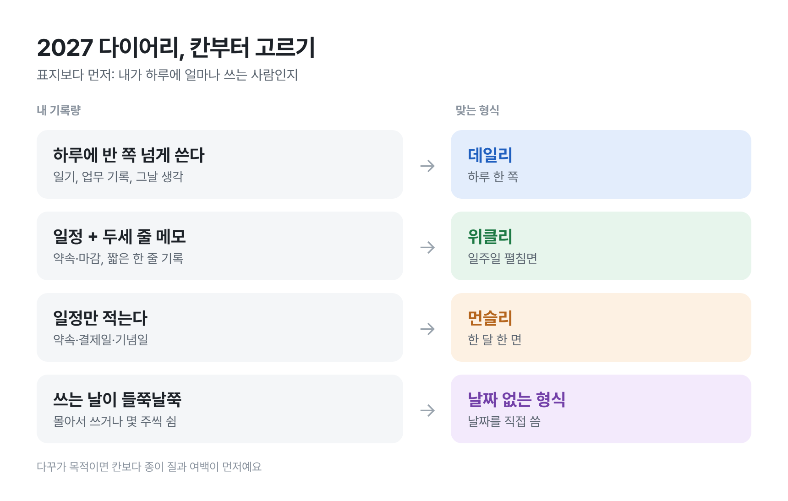

# [원고] T02 · 2027 다이어리

| 항목 | 내용 |
|---|---|
| 상태 | AI 완성 원고 → **사용자 손질 대기** |
| 채널 | 네이버·티스토리 공통 (해요체) |
| 장르 · 변형 | 비교 · 기록량으로 고르기 |
| 각도 | 다이어리가 멈추는 건 의지보다 칸 크기와 내 기록량이 안 맞아서일 때가 많다 |
| 게시 적기 | 지금 ~ 11/15 (얼리버드 진행 중, 연말 수요 전) |
| 대가성 표기 | 없음. 제휴 링크를 넣으면 제목 바로 아래 첫 줄에 문구 추가 ([05](../../05_생성규칙.md) 6절) |
| 붙여넣기 | `붙여넣기.html`을 브라우저로 열어 전체 복사 → 에디터에 붙여넣기 |

## 손질하면 좋아지는 곳 (사용자 몫)

AI가 대신 쓸 수 없는 부분이다. 하나만 해도 글이 '정보 글'에서 '내 글'로 바뀐다.

1. **도입 둘째 문단 뒤에 한 줄:** 내 다이어리가 실제로 멈춘 달. 예) "제 건 4월 둘째 주에서 멈춰 있더라고요."
2. **사진 1:** 멈춘 페이지를 펼친 내 다이어리. 없으면 그 자리를 지운다.
3. **제휴:** 추천할 제품을 정해 링크를 넣는다면 대가성 문구를 함께 넣는다 (네이버는 쇼핑커넥트, 티스토리는 쿠팡파트너스).
4. 스타벅스 다이어리 e-프리퀀시 공지가 뜨면 한 줄을 넣을지 정한다 (올해 일정은 미확인이라 본문에서 뺐다).

## 이미지

| # | 역할 | 준비 | 캡션 |
|---|---|---|---|
| 사진 1 | 장면 (도입) | **필요:** 사용자 다이어리. 선택 사항 | 사진에 맞춰 사용자가 한 줄 |
| 그림 1 | 비교 도식 | ✅ `그림1_칸부터고르기.png` (직접 제작) | 왼쪽에서 내 쪽을 찾고, 오른쪽 칸 크기로 넘어가면 돼요 |

## 확인한 사실

| 사실 | 출처 | 확인 |
|---|---|---|
| 몰스킨 2027 다이어리 컬렉션 출시 | [뉴스플릭스](https://www.newsflix.co.kr/news/articleView.html?idxno=32217) | 10-15 검색 발췌 |
| 호보니치 2027 내지·커버 국내 판매처 입고 | [베스트펜](https://www.bestpen.kr/m/product.html?branduid=72541&xcode=221&type=X) | 10-15 검색 발췌 |
| 에이블리 2027 다이어리 얼리버드 ~10/18 | [세계일보](https://www.segye.com/newsView/20261013506731) | 10-14 검색 발췌 |
| 날짜 있는 다이어리는 빈 페이지가 보여 다시 쓰게 하고, 날짜 없는 형식은 빈 페이지가 안 남아 부담이 적다 | [이투데이](https://www.etoday.co.kr/news/view/2522115) | 10-15 검색 발췌 |
| 태블릿용 2027 속지 5,780~13,900원 | 다음 쇼핑, [10-14 일일 조사](../../../../../시장조사/15_일일아이디어_2026-10-14.md) | 10-14 |

---

<!-- 본문 시작 -->

# 2027 다이어리 고르기 전에, 올해 다이어리가 몇 월에 멈췄는지부터 봐요

> 제목 대안: 데일리·위클리·먼슬리, 끝까지 쓰는 다이어리는 칸 크기가 정해요 / 2027 다이어리, 표지보다 먼저 정할 한 가지

올해 다이어리, 지금 어디쯤 펼쳐져 있나요?

마지막으로 글씨가 있는 페이지를 찾아보면 생각보다 금방 나와요. 3월일 수도 있고, 5월일 수도 있고요. 😅

> 📷 사진 1: 멈춘 페이지를 펼친 내 다이어리 (없으면 이 줄 삭제)

그런데 문구점이랑 쇼핑몰에는 벌써 2027 다이어리가 깔리기 시작했어요. 몰스킨은 2027 컬렉션을 내놨고, 호보니치 2027 내지도 국내 판매처에 들어왔어요. 에이블리는 10월 18일까지 얼리버드를 하고 있고요.

표지를 고르기 전에 딱 하나만 먼저 정해 보면 좋겠어요.

**나는 하루에 얼마나 쓰는 사람인가.**

## 다이어리가 멈추는 건 의지보다 칸 문제일 때가 많아요

하루 한 쪽짜리 데일리를 샀는데 실제로는 일정 두 줄만 적는 사람이라면, 매일 한 쪽의 4분의 3이 비어요. 그게 일주일 쌓이면 펼치기가 싫어지죠.

반대로 생각이 많은 날 길게 쓰고 싶은 사람이 먼슬리를 사면, 칸이 손톱만 해서 결국 메모 앱으로 넘어가고요.

"역시 난 꾸준하지 못해"로 정리하기 전에, 칸 크기와 내 기록량이 맞았는지 먼저 보는 게 순서 같아요.

*왼쪽에서 내 쪽을 찾고, 오른쪽 칸 크기로 넘어가면 돼요.*

## 형식별로 멈추기 쉬운 지점

| 형식 | 한 칸 | 잘 맞는 사람 | 멈추기 쉬운 지점 |
|---|---|---|---|
| 데일리 | 하루 한 쪽 | 일기·업무 기록을 길게 쓰는 사람 | 바쁜 주에 빈 쪽이 쌓일 때. 두껍고 무거워 안 들고 다니게 됨 |
| 위클리 | 일주일 펼침면 | 일정과 짧은 메모를 같이 보는 사람 | 길게 쓰고 싶은 날 칸이 모자람 |
| 먼슬리 | 한 달 한 면 | 일정만 정리하는 사람 | 기록하고 싶은 마음이 있으면 금방 심심해짐 |
| 날짜 없는 형식 | 날짜를 직접 씀 | 몰아서 쓰거나 몇 주씩 쉬는 사람 | 날짜 쓰는 게 귀찮고, 빈 쪽이 안 보여 덜 쓰게 될 수도 |

날짜 없는 형식은 장단점이 딱 뒤집혀 있어요. 날짜가 인쇄된 다이어리는 한 주를 건너뛰면 빈 페이지가 보여서 다시 쓰게 만드는 힘이 있어요. 날짜가 없으면 아프거나 여행 간 주에도 빈 페이지가 안 남아 부담이 적고요. 어느 쪽이 나한테 자극이 되는지는 사람마다 달라요.

태블릿으로 가는 방법도 있어요. 2027 속지는 10월 중순 기준으로 5천 원대에서 1만 원대 초반에 팔리고 있었어요. 지우고 옮기기 편한 대신, 기기를 꺼내는 그 한 번이 은근히 큰 문턱이라는 건 알고 고르면 좋겠어요.

## 고르는 순서

1. 올해 다이어리에서 마지막으로 쓴 달을 확인해요.
2. 다음 일주일 동안 메모 앱이든 종이든, 하루에 실제로 몇 줄 쓰는지 대충 봐요.
3. 들고 다닐지, 책상에 둘지 정해요. 크기와 무게는 여기서 정해져요.
4. 그다음에 표지랑 브랜드를 봐요.

순서만 바꿔도 "예뻐서 샀는데 안 쓰는" 다이어리가 줄어요.

## 이 기준이 안 맞는 경우

다꾸가 목적이라면 얘기가 달라요. 그때는 칸 크기보다 종이가 펜이랑 스티커를 얼마나 잘 받는지, 꾸밀 여백이 얼마나 되는지가 먼저예요. 기록보다 꾸미는 시간 자체가 즐거운 거니까요.

올해 다이어리가 봄에 멈췄다면, 2027년에는 한 단계 작은 칸을 골라 보세요. 칸이 남아서 지치는 것보다, 조금 모자라서 다음 장으로 넘기는 쪽이 끝까지 가기 쉬우니까요.

<!-- 본문 끝 -->

---

태그: 2027다이어리, 다이어리추천, 위클리다이어리, 데일리다이어리, 먼슬리다이어리, 다이어리고르기, 호보니치, 몰스킨, 다꾸

소개: 데일리·위클리·먼슬리·날짜 없는 형식 중 내 기록량에 맞는 2027 다이어리를 고르는 순서.
