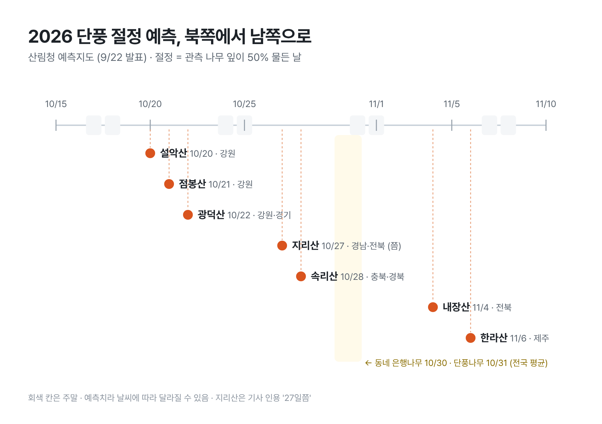

# [원고] T03 · 단풍 절정

| 항목 | 내용 |
|---|---|
| 상태 | AI 완성 원고 → **사용자 손질 대기** |
| 채널 | 네이버·티스토리 공통 (해요체) |
| 장르 · 변형 | 해설 · 흔한 혼란 하나를 풀고 날짜로 |
| 각도 | 사이트마다 절정 날짜가 다른 건 기준이 달라서다. 날짜 하나보다 앞뒤 일주일과 '남쪽으로 내려오는 순서'로 계획한다 |
| 게시 적기 | **지금 ~ 10/18** (설악산 절정 10/20 직전이 가장 많이 찾을 때) |
| 대가성 표기 | 없음 |
| 붙여넣기 | `붙여넣기.html` |
| 주제 교체 | 첫 시험의 경험 글 자리(편의점 디저트·할로윈)는 사진·메모가 없어 T03으로 바꿨다 ([06](../../06_주제후보_2026-10.md) 2절의 규칙) |

## 손질하면 좋아지는 곳 (사용자 몫)

1. **사진 1 (대표 이미지):** 직접 찍은 단풍 사진. 몇 년 전 사진이어도 된다. 캡션은 사진에 맞춰 한 줄 (예: "재작년 10월 말 내장산, 이때가 딱이었어요").
2. 올해 실제로 갈 곳이 있으면 마지막 문단 앞에 한 줄 ("저는 속리산 쪽을 보고 있어요").
3. **지리산 날짜 확인:** "10월 27일쯤"은 기사 인용만 있고 출처 기사를 특정하지 못했다. 산림청 예측지도에서 확인하거나 표에서 뺀다.

## 이미지

| # | 역할 | 준비 | 캡션 |
|---|---|---|---|
| 사진 1 | 장면 (대표) | **필요:** 사용자 단풍 사진. 없으면 그림 1을 대표 이미지로 | 사진에 맞춰 사용자가 한 줄 |
| 그림 1 | 정보 (시기표) | ✅ `그림1_단풍절정예측.png` (직접 제작) | 북쪽에서 시작해 2주 반 동안 남쪽으로 내려와요 |

라이선스 사진(Unsplash·공공누리 1유형)을 쓰는 방법도 있지만, 실제 그 산의 올해 사진처럼 보이게 쓰지 않는다.

## 확인한 사실

| 사실 | 출처 | 확인 |
|---|---|---|
| 산림청 '2026년 한반도 단풍 절정 예측지도' 9/22 발표. 절정 = 관측 나무 잎 50% 물든 시점 | [경향신문](https://www.khan.co.kr/article/202609221040001/), [정책브리핑](https://www.korea.kr/briefing/pressReleaseView.do?newsId=156782827) | 10-15 검색 발췌 |
| 다른 기관은 산 전체 80% 등 다른 기준. 산림청이 단순 비교하지 말라고 안내 | [경향신문](https://www.khan.co.kr/article/202609221040001/) | 10-15 검색 발췌 |
| 설악산 10/20, 점봉산 10/21, 광덕산 10/22, 속리산 10/28, 내장산 11/4, 한라산 11/6 | [강원일보](https://kwnews.co.kr/article/20260927500986), [위키트리](https://www.wikitree.co.kr/articles/1161270) | 10-15 검색 발췌, 여러 기사 일치 |
| 지리산 10/27쯤 | 검색 요약 (출처 기사 특정 못 함) | **게시 전 확인 필요** |
| 은행나무 전국 평균 10/30, 단풍나무·참나무 10/31. 최근 5년 평균보다 약 0.8일 늦음. 첫 단풍 9/14 점봉산 | [서울경제](https://m.sedaily.com/article/20093794), [경향신문](https://www.khan.co.kr/article/202609221040001/) | 10-15 검색 발췌 |

---

<!-- 본문 시작 -->

# 단풍 절정 날짜가 사이트마다 다른 이유, 그래서 언제 가면 될까

> 제목 대안: 설악산 10월 20일, 한라산 11월 6일: 올해 단풍 절정 예측 정리 / 단풍 절정을 놓쳤다면 남쪽으로: 2026 단풍 날짜 한눈에

설악산 단풍 절정이 10월 20일이라는 글을 봤는데, 다른 데서는 다른 날짜를 봤다면요. 둘 중 하나가 틀린 게 아닐 수도 있어요.

> 📷 사진 1: 직접 찍은 단풍 사진 (없으면 이 줄 삭제)

## 날짜가 다른 건 '절정'의 기준이 달라서예요

산림청은 9월 22일에 '2026년 한반도 단풍 절정 예측지도'를 냈어요. 여기서 말하는 절정은 **관측하는 나무의 잎이 50% 물든 날**이에요.

다른 곳은 산 전체의 80% 정도가 물든 때를 절정으로 잡기도 해요. 기준이 다르니 날짜도 달라지고, 산림청도 인터넷에 올라온 날짜들을 단순 비교하지 말라고 따로 당부했어요.

그러니까 같은 설악산이라도 산림청 기준 절정일은 '충분히 물들기 시작한 날'에 가깝고, 산 전체가 빨갛게 덮인 장면은 그보다 조금 뒤일 수 있다는 얘기예요.

## 올해 예측은 이래요

*북쪽에서 시작해 2주 반 동안 남쪽으로 내려와요.*

| 산 | 예측 절정 |
|---|---|
| 설악산 | 10월 20일 |
| 점봉산 | 10월 21일 |
| 광덕산 | 10월 22일 |
| 지리산 | 10월 27일쯤 |
| 속리산 | 10월 28일 |
| 내장산 | 11월 4일 |
| 한라산 | 11월 6일 |

나무 종류별 전국 평균은 은행나무가 10월 30일, 단풍나무와 참나무가 10월 31일이에요. 최근 5년 평균보다 0.8일쯤 늦다고 하니, 예년과 거의 비슷한 셈이에요.

오대산이나 북한산처럼 표에 없는 산은 산림청 예측지도 원본에서 찾아보는 게 정확해요.

## 그래서 언제 가면 될까

예측일 하루에 딱 맞추려고 하면 오히려 꼬여요. 이렇게 잡으면 편해요.

1. **예측일 앞뒤 일주일을 후보로 둬요.** 예측은 예측이라, 날씨에 따라 며칠씩 당겨지기도 밀리기도 해요.
2. **떠나기 2~3일 전에 지금 사진을 확인해요.** 국립공원이나 지자체 SNS에 올라오는 현장 사진이 어떤 예측보다 정확해요.
3. **주말보다 평일, 아니면 이른 아침.** 절정 주말에는 주차장부터 막히는 곳이 많아요.

## 놓쳤다면 남쪽으로

설악산 날짜를 놓쳐도 끝난 게 아니에요. 10월 20일 설악산에서 11월 6일 한라산까지, 단풍이 남쪽으로 내려오는 데 17일이 걸려요.

강원도를 놓치면 속리산(10/28), 그다음은 내장산(11/4)이에요. 멀리 갈 시간이 없다면 동네 은행나무길이 10월 말에 절정이니, 퇴근길에 한 정거장 먼저 내려서 걷는 것도 방법이고요.

한 번 놓쳤다면 지도에서 한 칸 아래를 보면 돼요. 올해 단풍은 11월 6일 한라산까지 내려오니까요. 🍁

<!-- 본문 끝 -->

---

태그: 단풍절정, 2026단풍, 단풍시기, 설악산단풍, 속리산단풍, 내장산단풍, 한라산단풍, 단풍예측지도, 가을여행

소개: 산림청 2026 단풍 절정 예측(설악산 10/20~한라산 11/6)과 사이트마다 날짜가 다른 이유, 언제 가면 좋은지.
