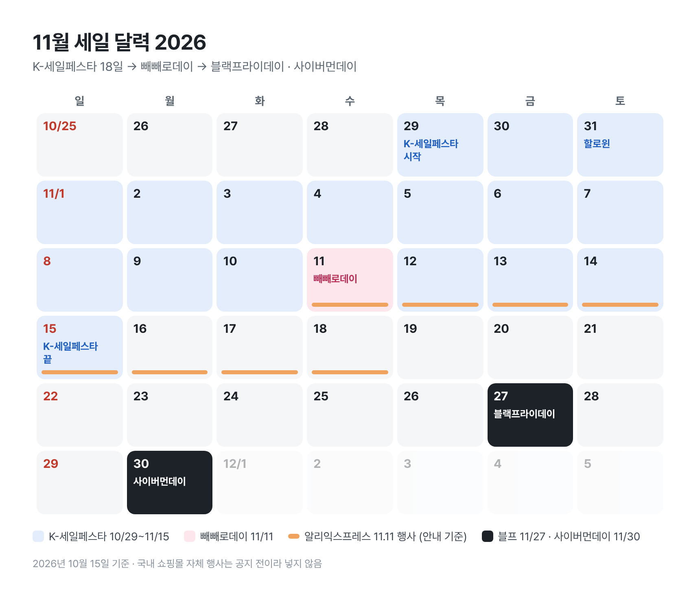

# [원고] T06 · 11월 세일 달력

| 항목 | 내용 |
|---|---|
| 상태 | AI 완성 원고 → **사용자 손질 대기** |
| 채널 | 네이버·티스토리 공통 (해요체) |
| 장르 · 변형 | 해설 · 날짜를 먼저, 품목별 판단은 뒤에 |
| 각도 | 11월 세일은 블프 하루가 아니라 10/29부터 한 달짜리다. 품목에 따라 볼 행사가 다르다 |
| 게시 적기 | **10/22 ~ 10/28** (K-세일페스타 개막 전) |
| 대가성 표기 | 없음. 쿠팡·쇼핑커넥트 링크를 넣으면 제목 아래 첫 줄에 문구 추가 |
| 붙여넣기 | `붙여넣기.html` |

## 손질하면 좋아지는 곳 (사용자 몫)

1. **사진 1:** 내 장바구니 화면 캡처 (가격이 보이게). "할인율보다 먼저 할 일"이 실제 행동으로 보인다. 개인 정보는 가린다.
2. 올해 11월에 실제로 사려는 물건이 있으면 한 줄 넣는다. 예) "저는 이번에 겨울 이불을 노리고 있어요."
3. 10/25 이후 K-세일페스타 참여사 목록이 나오면, 눈에 띄는 브랜드 두세 개를 덧붙일지 정한다.
4. 11번가·G마켓·무신사 공지가 나오면 달력을 새로 만들지 정한다 (그림은 Claude가 다시 만들 수 있다).

## 이미지

| # | 역할 | 준비 | 캡션 |
|---|---|---|---|
| 그림 1 | 정보 (달력) | ✅ `그림1_11월세일달력.png` (직접 제작) | 파란 칸이 K-세일페스타, 검은 칸이 블프와 사이버먼데이예요 |
| 사진 1 | 증거·행동 | **필요:** 사용자 장바구니 캡처. 선택 사항 | 사진에 맞춰 사용자가 한 줄 |

## 확인한 사실

| 사실 | 출처 | 확인 |
|---|---|---|
| K-세일페스타 2026: 10/29(목)~11/15(일), 18일. 코리아세일페스타에서 이름 변경, 코리아그랜드페스티벌의 일부 | [교수신문](https://www.kyosu.net/news/articleView.html?idxno=209853), [지피코리아](https://www.gpkorea.com/news/articleView.html?idxno=146333) | 10-15 검색 발췌, 여러 기사 일치 |
| 할인 분야: 푸드·패션·뷰티·자동차·가전. 참가 신청 9/4~10/25 | 같은 기사 | 10-15 검색 발췌 |
| 빼빼로데이 협업 한정판 (스트레이 키즈·산리오·가나디) | [뉴스후플러스](https://www.newswhoplus.com/news/articleView.html?idxno=71685) | 10-14 검색 발췌 |
| 알리익스프레스 11.11 행사 11/11~11/18 | [promossale](https://promossale.com/aliexpress-sale-dates-2026/) | **2차 자료.** 게시 전 알리 공지로 재확인 권장 |
| 블랙프라이데이 11/27(금), 추수감사절 11/26, 사이버먼데이 11/30 | [National Today](https://nationaltoday.com/black-friday/), [뱅크샐러드](https://www.banksalad.com/articles/블랙프라이데이-세일기간과-해외직구-꿀팁) | 달력으로도 확인 |
| 11번가·G마켓·무신사 등 2026 행사 일정 | — | **미발표** (10-15 검색에서 찾지 못함) |

---

<!-- 본문 시작 -->

# 11월 세일 달력 한 장으로: K-세일페스타부터 블랙프라이데이까지

> 제목 대안: 코리아세일페스타 이름 바뀐 거 아세요? 11월 세일 날짜 정리 / 11월에 뭘 언제 살지, 세일 날짜부터 정리했어요

올해 11월 세일은 10월 29일에 시작해요. 그것도 18일짜리로요.

작년까지 '코리아세일페스타'라고 부르던 행사가 올해부터 **K-세일페스타**로 이름을 바꿨어요. 기간은 10월 29일(목)부터 11월 15일(일)까지. 이름이 바뀐 걸 모르고 옛 이름으로 찾으면 작년 글이 잔뜩 나와서 헷갈릴 수 있어요.

11월에 몰려 있는 날짜를 한 장에 모아 봤어요.

*파란 칸이 K-세일페스타, 검은 칸이 블프와 사이버먼데이예요.*

## K-세일페스타는 뭐가 달라졌나요?

이름만 바뀐 게 아니라, 정부가 여는 소비 축제인 '코리아그랜드페스티벌' 안으로 들어갔어요. 할인 분야는 푸드·패션·뷰티·자동차·가전처럼 생활에 가까운 쪽이고요.

어떤 브랜드가 참여하는지는 아직 몰라요. 참가 신청을 10월 25일까지 받고 있어서, 목록은 그 뒤에 공식 홈페이지에 올라올 가능성이 커요.

## 11월 11일은 할인보다 선물 날에 가까워요

빼빼로데이는 수요일이에요. 올해는 스트레이 키즈, 산리오, 가나디와 협업한 한정판이 나왔어요. 이런 건 할인을 기다리기보다 품절 전에 사는 게 관건이에요.

같은 날 알리익스프레스도 11.11 행사를 시작해요. 11월 18일까지로 안내돼 있어요. 해외 배송이라 받는 날짜는 넉넉하게 잡는 게 좋아요.

## 블랙프라이데이는 11월 27일

올해 미국 추수감사절이 11월 26일(목)이라, 블랙프라이데이는 다음 날인 **11월 27일 금요일**, 사이버먼데이는 **11월 30일 월요일**이에요.

직구할 생각이라면 가격 말고도 두 가지를 같이 보세요.

- **면세 한도:** 넘으면 관세와 부가세가 붙어서 할인이 줄어요. 한도는 관세청 기준으로 한 번 확인하고 담는 게 안전해요.
- **배송 기간:** 연말 선물용이면 도착 날짜를 거꾸로 세어 봐야 해요.

## 그래서 뭘 언제 사면 될까

날짜는 나왔고, 남은 건 순서예요. 품목별로 나눠 보면 덜 헷갈려요.

| 사려는 것 | 먼저 볼 때 | 이유 |
|---|---|---|
| 국내 브랜드 생활용품·식품·화장품 | K-세일페스타 (10/29~11/15) | 생활 밀접 분야 중심 행사 |
| 빼빼로·선물용 한정판 | 11/11 전 주 | 할인보다 품절이 문제 |
| 해외 브랜드 가전·IT·의류 직구 | 블프~사이버먼데이 (11/27~30) | 해외 쇼핑몰 행사가 이때 열림 |
| 급하지 않은 큰 물건 | 두 행사 다 지켜보기 | 가격을 비교할 시간이 있음 |

행사 성격으로 나눈 표라서, 특정 제품이 어디서 더 싸다는 뜻은 아니에요. 같은 물건도 쇼핑몰마다 할인 폭이 달라요.

## 할인율보다 먼저 할 일

지금 사고 싶은 물건을 장바구니에 넣고, 오늘 가격을 적어 두세요. 행사 직전에 가격을 올렸다가 큰 할인율을 붙이는 경우를 바로 걸러낼 수 있어요.

> 📷 사진 1: 가격이 보이는 내 장바구니 캡처 (없으면 이 줄 삭제)

## 아직 비어 있는 칸

11번가, G마켓, 무신사 같은 쇼핑몰 자체 행사는 올해 날짜가 아직 안 나왔어요. 11월에 큰 행사를 해 온 곳들이라, 공지가 뜨면 이 달력도 더 빽빽해질 거예요.

블프 하루를 기다리기보다, 10월 29일 전에 장바구니부터 정리해 두면 세일이 몰린 한 달을 훨씬 가볍게 지나갈 수 있어요.

<!-- 본문 끝 -->

---

태그: 11월세일, K세일페스타, 코리아세일페스타, 블랙프라이데이, 사이버먼데이, 빼빼로데이, 광군제, 직구, 세일달력

소개: 2026 K-세일페스타(10/29~11/15), 빼빼로데이, 블랙프라이데이(11/27) 날짜와 품목별로 언제 보면 좋은지 한 장에.
